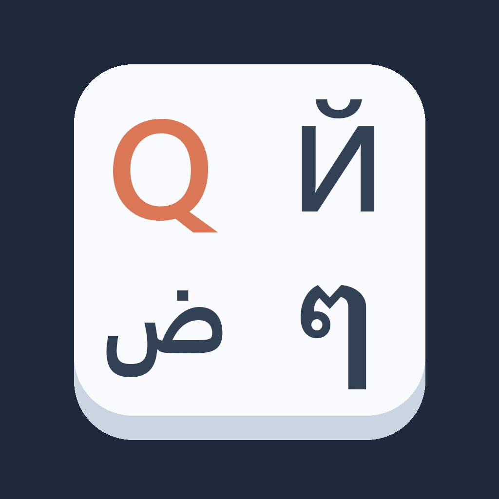

# Keyboard Layout Fixer



Typed a whole message with the wrong keyboard layout active? Send it to Claude anyway. This skill notices
the scrambled text, reads it back on the layout you meant, and answers what you meant.

| you typed | layout you meant | Claude reads |
|---|---|---|
| `ghbdtn` | Russian | привет |
| `akuo` | Hebrew | שלום |
| `lvpfh` | Arabic | مرحبا |
| `vcmdls` | Hindi (INSCRIPT) | नमस्ते |
| `dkssudgktpdy` | Korean | 안녕하세요 |
| `руддщ` | English | hello |

It covers 31 layouts: Cyrillic, Greek, Hebrew, Arabic, Persian, Urdu, Thai, Lao, Khmer, Myanmar,
Georgian, Armenian, Indic scripts, Korean (Dubeolsik) and US English. Chinese, Japanese and Vietnamese
type through an input method, so they are not covered.

## Install

In Claude Code:

```
/plugin install keyboard-layout-fixer --marketplace PattrickChenforclaudeuse/keyboard-layout-fixer
```

On claude.ai, upload `keyboard-layout-fixer-skill.zip` from the repository's Releases page under
Settings → Capabilities → Skills.

## How to use

Nothing to set up. Type with the wrong layout, send the message, and Claude answers the corrected text
with a one-line note of how it read it. You can also ask directly: "I typed this on the wrong keyboard:
ghbdtn". Text that is meant as written, such as URLs, code, numbers or `555` (Thai laughter), is left alone.

## What it runs

The skill contains one Python script, `skills/keyboard-layout-fixer/convert.py`, and a data file,
`layouts.json`. When Claude can run code, it runs `convert.py` on the scrambled text to list every
layout's reading, then picks the one that means something. The script uses only the Python standard
library, reads only `layouts.json`, and prints to the terminal. It makes no network requests, writes
no files and keeps no data. Without code execution, Claude reads `layouts.json` directly.

The keyboard tables come from Unicode CLDR release 43 (Windows layouts). The tools that build and check
them are in the repository: https://github.com/PattrickChenforclaudeuse/keyboard-layout-fixer

## License

MIT. Keyboard tables are derived from Unicode CLDR (Unicode License).
